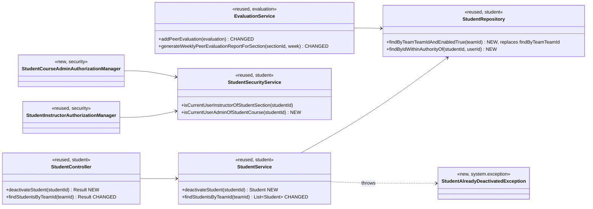
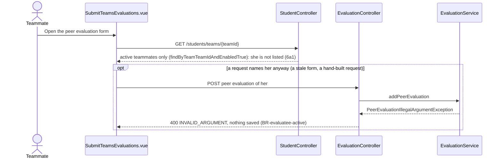

# Student (STU) Design

> Realizes: UC-STU-deactivate-student
> Depends on: FR-SEC-active-account, FR-SEC-authorization, FR-SEC-deny-unauthorized; BR-student-lifecycle, BR-evaluatee-active, BR-submission-owed, BR-section-scoped-access, BR-role-based-access
> See: [use cases](../requirements/use-cases.md#student), [business rules](../requirements/business-rules.md), [architectural-design.md](architectural-design.md#shared-foundation-components) (shared-foundation component view, Crosscutting Concepts)
> Designed against `main` at `59f0267` (2026-11-05).

## Overview

The `student` slice in the REST API container holds a student's account within her course section: finding, viewing, editing, deleting, and (with this design) deactivating her. The other STU use cases were built before this spec set existed and are mapped in [`traceability.md`](../traceability.md); this doc starts with UC-STU-deactivate-student and grows as the area's other use cases are designed.

Before this design, deactivation existed only as the `enabled` flag that the generic `PUT /students/{studentId}` lets any `ROLE_instructor` set. That path has no warning or confirmation step, and its guard (`UserOwnershipAuthorizationManager`) admits only the course section's assigned instructors, so the course admin who owns the course is refused, contrary to BR-student-lifecycle. Deactivation also stopped at login: her teammates were still asked to rate her, `EvaluationService.addPeerEvaluation` accepted those ratings, and the course section's peer evaluation report listed her every week.

## Components & classes



- **Backend, `student/`:** `StudentController.deactivateStudent` and `StudentService.deactivateStudent` (new). `StudentService.findStudentsByTeamId` switches to the new `StudentRepository.findByTeamTeamIdAndEnabledTrue`; its only caller is `StudentController.findStudentsByTeamId`, and `findByTeamTeamId` has no caller but that service method (`SubmissionStatusService` and the report load students through `findBySectionSectionId`), so the narrowing reaches no other server path; `findByTeamTeamId` is replaced by the new method rather than kept beside it. `StudentSecurityService.isCurrentUserAdminOfStudentCourse` (new) compares the caller's JWT `userId` with `student.section.course.courseAdmin`, the same check `InstructorSecurityService.isCurrentUserAdminOfInstructorCourse` makes for instructors, and fails closed (a missing student is `false`, never an exception), as the class's existing methods do.
- **Backend, `security/authorizationmanagers/`:** `StudentCourseAdminAuthorizationManager` (new) reads `studentId` and delegates to `isCurrentUserAdminOfStudentCourse`. It is composed with the existing `StudentInstructorAuthorizationManager`, which admits the caller when she is in `student.section.instructors` (the course section's assigned instructors, not the team's instructor). The rule in `SecurityConfiguration` is an exact `requestMatchers(HttpMethod.PATCH, baseUrl + "/students/{studentId}/deactivate")` in the `/students/**` block; the block's other matchers are exact patterns that do not match this path, so its position within the block is free, as long as it precedes the `denyAll()` catch-all.
- **Backend, `system/exception/`:** `StudentAlreadyDeactivatedException` (new), mapped in `ExceptionHandlerAdvice` with `@ResponseStatus(HttpStatus.CONFLICT)` to `Result(false, StatusCode.CONFLICT, message)`; `StatusCode.CONFLICT` (`409`) already exists.
- **Backend, `evaluation/`:** `EvaluationService.addPeerEvaluation` rejects an evaluatee whose account is inactive, with a check placed after the same-team check and before the duplicate check. Each `POST /evaluations` carries one evaluatee, and the form posts one per teammate, so a refusal saves nothing and touches no other evaluation; the server has no "every member was evaluated" check to narrow (completeness is the form's, over the teammates it lists). `generateWeeklyPeerEvaluationReportForSection` drops a student whose account is inactive when no evaluations of her exist that week. It loads each student's evaluations once and builds her row through the private `toPeerEvaluationAverage(week, student, evaluations)`, extracted from `getPeerEvaluationAverage` (which still loads and delegates) so the rows are not read twice. "Evaluations of her" are the rows with her as evaluatee, her self-evaluation included; the evaluations she wrote of others stay in their reports as they are, and students on no team stay excluded as today.
- **Frontend:** `src/apis/student/index.ts` adds `deactivateStudent(id)` on the shared `request` instance. `pages/students/Students.vue` adds a Deactivate button to the Operations column, shown only when `row.enabled`. That row is where UC-STU-view-student is realized (`traceability.md`), so steps 2–3 happen there and "refreshes her details" (3a2) is a list reload. The button opens `ElMessageBox.confirm` (type `warning`, title "Deactivate a student", buttons "Deactivate" and "Cancel") whose body states the consequences in the use case's Associated Information: she can no longer log in or submit weekly activity reports and peer evaluations; her account, submitted work, team, and course section are kept; she can be reactivated. On success the page shows `ElMessage.success('The student has been deactivated.')` (step 6) and reloads the list; the API message "Deactivate student successfully" is not shown. On a rejected request the shared interceptor has already toasted the server message (a `409`) or routed to the forbidden page (a `403`), so the page only catches the rejection, adds no second toast, and reloads the list. The list is already scoped to the caller's own course section, so the button needs no per-row permission check. `pages/evaluations/SubmitTeamsEvaluations.vue` is unchanged: new submissions list active teammates only, and update mode reloads the evaluator's existing evaluations (an evaluation of her written before the deactivation included) and re-saves them through the unchanged `PUT /evaluations/{evaluationId}`.

## Sequence

### UC-STU-deactivate-student: deactivate a student

```mermaid
sequenceDiagram
    actor U as Course admin / instructor
    participant SPA as Students.vue
    participant SEC as Filter chain
    participant SC as StudentController
    participant SS as StudentService
    participant DB as StudentRepository
    U->>SPA: Find students and view her row (steps 1-2, UC-STU-find-students, UC-STU-view-student)
    Note over SPA: Deactivate is shown only when row.enabled (3a1)
    U->>SPA: Deactivate (step 3)
    SPA-->>U: Consequences, warning, Confirm or Cancel (step 4)
    alt Cancel (5a)
        SPA-->>U: Nothing is sent
    else Confirm (step 5)
        SPA->>SEC: PATCH /students/{studentId}/deactivate
        alt neither an assigned instructor nor the owning course admin (3b)
            SEC-->>SPA: 403 Result envelope, nothing changes
        else permitted
            SEC->>SC: deactivateStudent(studentId)
            SC->>SS: deactivateStudent(studentId)
            SS->>DB: findByIdWithinAuthorityOf(studentId, caller)
            alt already inactive (3a2)
                SS-->>SC: StudentAlreadyDeactivatedException
                SC-->>SPA: 409 "The student is already deactivated."
                SPA-->>U: Interceptor toasts the message, page reloads the list (refreshes her details)
            else active
                SS->>DB: save, enabled false; team and course section untouched
                SC-->>SPA: 200 StudentDto, enabled false
                SPA-->>U: "The student has been deactivated.", list reloads with the Disabled tag (step 6)
            end
        end
    end
    Note over U,DB: Her next login fails: MyUserPrincipal.isEnabled() is false, so DisabledException and 401 (FR-SEC-active-account). A token issued earlier stays valid until it expires (OI-65).
```

### UC-STU-deactivate-student 6a: her teammates' peer evaluations



The student's account has two states, active and inactive, and this use case draws only the active-to-inactive edge; UC-STU-reactivate-student owns the other one. That is too small for a state diagram.

## API contract

| Endpoint or job | Caller (who may) | Request | Success | Errors, by extension |
|---|---|---|---|---|
| `PATCH /api/v1/students/{studentId}/deactivate` (new) | Per BR-student-lifecycle: `AuthorizationManagers.anyOf(studentInstructorAuthorizationManager, studentCourseAdminAuthorizationManager)`, added before the `denyAll()` catch-all | No body | `200`, message "Deactivate student successfully", the `StudentDto` with `enabled: false` | 3a2, already inactive: `409` `CONFLICT`, "The student is already deactivated.", nothing changes. 3b, anyone the rule refuses (a student, herself included; an instructor not assigned to her course section; another course's admin; an id that names no student): `403` `FORBIDDEN` `Result` envelope, nothing changes |
| `GET /api/v1/students/teams/{teamId}` (changed) | Unchanged (`teamMembershipAuthorizationManager`) | Unchanged | `200`, the team's students whose account is active (6a1, BR-evaluatee-active) | Unchanged |
| `POST /api/v1/evaluations` (changed; `EvaluationService.addPeerEvaluation`) | Unchanged | Unchanged | Unchanged | Evaluatee's account inactive: `400` `INVALID_ARGUMENT`, "You can evaluate only a teammate whose account is active.", nothing saved (BR-evaluatee-active) |
| `GET /api/v1/evaluations/sections/{sectionId}/week/{week}` (changed; `generateWeeklyPeerEvaluationReportForSection`) | Unchanged | Unchanged | Lists each student on a team whose account is active, and a student whose account is inactive only when peer evaluations of her exist for that week (BR-evaluatee-active) | Unchanged |

## Key decisions

**A dedicated endpoint rather than the generic edit.** `PATCH /students/{studentId}/deactivate` carries only the intent. Rejected: `PUT /students/{studentId}` with `enabled: false`. Its guard refuses the owning course admin, it rewrites the name and email fields, and it gives the deactivate intent no route of its own to authorize or test.

**Authorization is composed, not widened, and enforced at both points.** Point 1, the route rule: the new route composes the existing `StudentInstructorAuthorizationManager` with a new course-admin manager using `anyOf`. This is the same shape as the NOT area's [Authorization](not.md#key-decisions) decision for course sections. Rejected: adding the course-admin check to `UserOwnershipAuthorizationManager`, which guards `GET`, `PUT`, and `DELETE /students/{studentId}` too and would open those to course admins without a use case asking for it. Point 2, the scoped load: the route is flat (it carries no course section id), so `StudentService.deactivateStudent` takes the caller from `UserUtils.getUserId()` and loads her through `StudentRepository.findByIdWithinAuthorityOf(studentId, userId)`, a query that finds her only for an instructor assigned to her course section or the course admin of its course, the same authority set as the route rule (BR-student-lifecycle). To any other caller she does not exist: `ObjectNotFoundException`, a `404`. The route rule answers `403` first, so that `404` is reached only if the rule is loosened, reordered, or copied to a route without it, which is the case the second point exists for ([Authorization](architectural-design.md#authorization)). Rejected: `findById` followed by a comparison in the service, which leaves the unscoped load in place. Rejected: scoping by the caller's default course section (`UserUtils.getUserSectionId()`, as `findByCriteria` does), which would refuse the owning course admin who is not assigned to the course section and an instructor assigned to it whose default is another one, both of whom BR-student-lifecycle permits.

**An already inactive student gets a `409`, not an idempotent `200`.** Rejected: an idempotent no-op. A second instructor would be told the student "has been deactivated" by an action that changed nothing, and 3a2 would have no response of its own to test.

**Deactivation changes only the active flag.** BR-student-lifecycle keeps her team and course section membership. Rejected: removing her from her team. That would lose the context of her recorded evaluations, require reactivation to restore it, and do UC-TEA-remove-student's job (BR-team-admin-only).

**Inactive teammates are filtered on the server.** `findStudentsByTeamId` returns active students only, and `addPeerEvaluation` refuses an inactive evaluatee. The existing method is narrowed rather than given a sibling, because the peer evaluation form (`SubmitTeamsEvaluations.vue`, through `apis/student` `findStudentsByTeamId`) is the only runtime caller of `GET /students/teams/{teamId}` (checked against `main` at `59f0267`; the other references are `StudentIntegrationTest`'s two team-listing tests). The team roster does not use it: `Teams.vue` fills each team's members from `POST /students/search`, filtered by `teamId` in the page, and `TeamDto` carries no students. So a deactivated student stays on her team's roster, with the Disabled tag, as BR-student-lifecycle requires. Any future caller that needs the whole team must use a separate method rather than widen this one. Rejected: keeping `findStudentsByTeamId` as is and adding an evaluation-only query (an `?active=true` parameter or a second repository method), which guards against a caller that does not exist. Rejected: filtering in the form. The rule would then live in two places, the server and a page, and a second caller of the endpoint would get the inactive students back. Rejected: an `includeInactive` query parameter, since there is no caller that wants them.

**Editing an evaluation recorded before her deactivation is unchanged.** BR-evaluatee-active governs submitting, and keeps evaluations already recorded. `updatePeerEvaluation` gets no new check, and the form no longer lists her, so there is nothing to edit through the page. Rejected: refusing updates too, which BR-evaluatee-active does not ask for.

**The report decides from the evaluations it already loads.** `generateWeeklyPeerEvaluationReportForSection` queries each student's evaluations for the week itself (`findByWeekAndEvaluateeId`), drops an inactive student when that list is empty, and hands the list to the private `toPeerEvaluationAverage(week, student, evaluations)` to build her row. `getPeerEvaluationAverage` still loads the evaluations and delegates to the same private method, so its other callers are unchanged. Rejected: a new repository query (`existsByWeekAndEvaluateeId`) in front of `getPeerEvaluationAverage`, which would read the same rows twice.

**The generic edit keeps the `enabled` toggle for now.** It is today's only way to reactivate a student. The design of UC-STU-reactivate-student retires it, as that use case's Associated Information states. Rejected: removing it now, which would leave no way to reactivate a student.

**No email to the student.** The use case has no notify step, unlike UC-STU-reactivate-student. Not added.

## Data model

No delta. Deactivation uses the existing `enabled` column of `PeerEvaluationUser` (the single-table user hierarchy that `Student` extends), as the SRS's [Business Domain Model](../requirements/software-requirements-specification.md#business-domain-model) defines it. `findByTeamTeamIdAndEnabledTrue` is a derived query and adds no index. No Flyway migration.

## Reuse & cross-cutting

- **Authentication:** `MyUserPrincipal.isEnabled()` already makes login fail for an inactive account (FR-SEC-active-account). Live tokens are unchanged and tracked as OI-65.
- **Authorization:** `StudentInstructorAuthorizationManager` (reused) composed with `anyOf`; the `403` envelope comes from `CustomBearerTokenAccessDeniedHandler`.
- **Error envelope:** `PeerEvaluationIllegalArgumentException` already maps to `400` / `INVALID_ARGUMENT`; the new `StudentAlreadyDeactivatedException` maps to `409` / `CONFLICT`. The SPA's shared `request` instance shows a `409` as a toast with the message and routes a `403` to the forbidden page, per the [client ↔ API contract](architectural-design.md#crosscutting-concepts).
- **Who owes what:** unchanged. `SubmissionStatusService` already applies BR-submission-owed, which excludes inactive students both as owing and as owed.

## Tests

Fixtures, from the `dev` seed (`DataInitializer`). The target student is Woody Allen (`w.allen@abc.edu`), on Team2 in course section 2023-2024 of COSC 40993 Senior Design. Peer evaluations of him exist for `2023-W31` only. The `dev` clock (2023-08-20) makes `2023-W32` the previous week, so his teammates' submission window for it is open. Course actors:
- Bingyang Wei (`b.wei`) owns the course and is also assigned to that course section.
- Bill Gates is assigned to the course section.
- Tim Cook owns another course (EE 30323) and is assigned to no course section of this one.

The seed has no plain instructor who is unassigned, so Tim stands in for both "instructor not assigned" and "another course's admin". Integration tests roll back after each test (`AbstractIntegrationTest` is `@Transactional`), so a test may change the seed.

| Use case, flow | Level | Asserts |
|---|---|---|
| UC-STU-deactivate-student main, owning course admin | integration | With `b.wei` first removed from the course section's instructors (inside the test, so the course-admin manager, not the instructor manager, admits him), `b.wei` deactivates Woody: `200`, `enabled: false`. Woody's HTTP Basic login then returns `401`. His activities and peer evaluations still exist, and `POST /students/search` still lists him on Team2 |
| UC-STU-deactivate-student main, assigned instructor | integration | Bill deactivates Woody: `200`, `enabled: false` |
| UC-STU-deactivate-student 3a1 | E2E (Cypress, API stubbed, `cy.intercept` as in `cypress/e2e/reminders.spec.cy.js`) | A row whose `enabled` is false shows no Deactivate button |
| UC-STU-deactivate-student 3a2 | integration | A second `PATCH` on Woody returns `409`, `flag: false`, message "The student is already deactivated."; Woody is unchanged |
| UC-STU-deactivate-student 3b | integration | Woody himself, John (another student), Tim (unassigned instructor, another course's admin), and an id that names no student each get `403` with the `Result` envelope; Woody stays active |
| UC-STU-deactivate-student 5a | E2E (Cypress, API stubbed) | Clicking "Cancel" in the confirmation sends no `PATCH` |
| UC-STU-deactivate-student 6a, form listing | integration | After Woody's deactivation, `GET /students/teams/{Team2 id}` with Amanda's token lists Amanda, Cora, and Agustin and not Woody |
| UC-STU-deactivate-student 6a, submission | integration | After Woody's deactivation, Amanda's `POST /evaluations` of Woody for `2023-W32` returns `400` with "You can evaluate only a teammate whose account is active."; no row is saved. Her evaluation of Cora for the same week still saves |
| UC-STU-deactivate-student 6a, report | integration | After Woody's deactivation, the course section's report omits him for `2023-W32` (no evaluations of him) and lists him for `2023-W31` (evaluations exist); Amanda, active, is listed in both weeks |
| `StudentService.deactivateStudent` | unit | Sets `enabled` false and saves; throws `StudentAlreadyDeactivatedException` when she is already inactive and `ObjectNotFoundException` for a missing id |
| `StudentSecurityService.isCurrentUserAdminOfStudentCourse` | unit | True only for the owning course admin; false for another course's admin and for a missing student |
| `StudentCourseAdminAuthorizationManager` | unit | `StudentCourseAdminAuthorizationManagerTest`: grants exactly what `isCurrentUserAdminOfStudentCourse` answers for the bound `studentId`; denies, without asking the service, when the matched route bound no `studentId` or one that is not a number |
| `EvaluationService.addPeerEvaluation` | unit | Rejects an inactive evaluatee before saving |
| `EvaluationService.generateWeeklyPeerEvaluationReportForSection` | unit | `EvaluationServiceTest.testGenerateWeeklyPeerEvaluationReportForSectionListsInactiveStudentOnlyWhenEvaluated`: an inactive student is listed, with her average, when evaluations of her exist that week, and omitted when none do; the active students are listed |

## Open questions / risks

- **Live tokens (OI-65).** A deactivated student keeps access for the rest of her token's 2-hour life, so she can still submit records and hold edit locks in that window. The locks lapse under BR-lock-expiry.
- **What reactivation makes owed.** BR-submission-owed decides what is owed from account status at the time, so reactivating her while the previous week's submission window is still open makes that week's items owed again, by her and of her (UC-STU-reactivate-student's Associated Information). The design of UC-STU-reactivate-student should decide whether that is wanted. Answering "no" needs a deactivation timestamp, which is a data-model change: the system records none today, so "active during that week" cannot be evaluated.
- **The EVA rows.** UC-EVA-submit-evaluation and UC-EVA-section-evaluation-report cite BR-evaluatee-active; their `traceability.md` Tests cells now name the `addPeerEvaluation` and report tests that verify it, so both stay `✅ Verified`.
- **Two deactivations at once.** Two `PATCH` requests that both read her as active both return `200`, and 3a2's `409` is not given to the second. Accepted: the result is the same inactive account either way, and adding row versioning to `PeerEvaluationUser` is out of proportion for an action used a few times a year.
- **The generic edit still bypasses confirmation.** Until UC-STU-reactivate-student retires the toggle, an instructor can still deactivate through the edit form with no warning step.
- **An inactive evaluator.** BR-evaluatee-active governs the evaluatee only. A student deactivated mid-session can still submit her own evaluations during the token window of OI-65; closing OI-65 closes this too.
