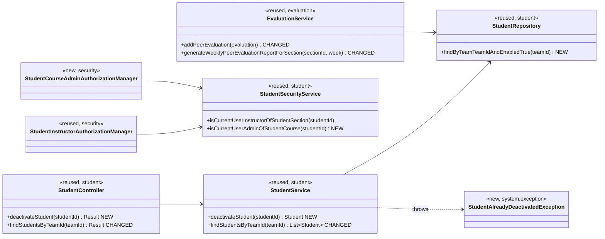
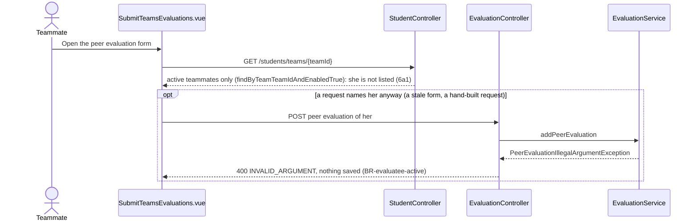

# Student (STU) Design

> Realizes: UC-STU-deactivate-student
> Depends on: FR-SEC-active-account, FR-SEC-authorization, FR-SEC-deny-unauthorized; BR-student-lifecycle, BR-evaluatee-active, BR-submission-owed, BR-section-scoped-access, BR-role-based-access
> See: [use cases](../requirements/use-cases.md#student), [business rules](../requirements/business-rules.md), [architectural-design.md](architectural-design.md#shared-foundation-components) (shared-foundation component view, Crosscutting Concepts)
> Designed against `main` at `59f0267` (2026-11-05).

## Overview

The `student` slice in the REST API container holds a student's account within her course section: finding, viewing, editing, deleting, and (with this design) deactivating her. The other STU use cases were built before this spec set existed and are mapped in [`traceability.md`](../traceability.md); this doc starts with UC-STU-deactivate-student and grows as the area's other use cases are designed.

Before this design, deactivation existed only as the `enabled` flag that the generic `PUT /students/{studentId}` lets any `ROLE_instructor` set. That path has no warning or confirmation step, and its guard (`UserOwnershipAuthorizationManager`) admits only the course section's assigned instructors, so the course admin who owns the course is refused, contrary to BR-student-lifecycle. Deactivation also stopped at login: her teammates were still asked to rate her, `EvaluationService.addPeerEvaluation` accepted those ratings, and the course section's peer evaluation report listed her every week.

## Components & classes



- **Backend, `student/`:** `StudentController.deactivateStudent` and `StudentService.deactivateStudent` (new). `StudentService.findStudentsByTeamId` switches to the new `StudentRepository.findByTeamTeamIdAndEnabledTrue`. `StudentSecurityService.isCurrentUserAdminOfStudentCourse` (new) compares the caller's JWT `userId` with `student.section.course.courseAdmin`, the same check `InstructorSecurityService.isCurrentUserAdminOfInstructorCourse` makes for instructors, and fails closed (a missing student is `false`, never an exception), as the class's existing methods do.
- **Backend, `security/authorizationmanagers/`:** `StudentCourseAdminAuthorizationManager` (new) reads `studentId` and delegates to `isCurrentUserAdminOfStudentCourse`. It is composed with the existing `StudentInstructorAuthorizationManager` in `SecurityConfiguration`.
- **Backend, `system/exception/`:** `StudentAlreadyDeactivatedException` (new), mapped in `ExceptionHandlerAdvice` to `409` / `CONFLICT`.
- **Backend, `evaluation/`:** `EvaluationService.addPeerEvaluation` rejects an evaluatee whose account is inactive. `generateWeeklyPeerEvaluationReportForSection` drops a student whose account is inactive when `getPeerEvaluationAverage` found no evaluations of her that week.
- **Frontend:** `src/apis/student/index.ts` adds `deactivateStudent(id)` on the shared `request` instance. `pages/students/Students.vue` adds a Deactivate button to the Operations column, shown only when `row.enabled`, which opens an `ElMessageBox.confirm` stating the consequences from the use case's Associated Information. `pages/evaluations/SubmitTeamsEvaluations.vue` is unchanged; it receives active teammates only.

## Sequence

### UC-STU-deactivate-student: deactivate a student

```mermaid
sequenceDiagram
    actor U as Course admin / instructor
    participant SPA as Students.vue
    participant SEC as Filter chain
    participant SC as StudentController
    participant SS as StudentService
    participant DB as StudentRepository
    U->>SPA: Find students and view her row (steps 1-2, UC-STU-find-students, UC-STU-view-student)
    Note over SPA: Deactivate is shown only when row.enabled (3a1)
    U->>SPA: Deactivate (step 3)
    SPA-->>U: Consequences, warning, Confirm or Cancel (step 4)
    alt Cancel (5a)
        SPA-->>U: Nothing is sent
    else Confirm (step 5)
        SPA->>SEC: PATCH /students/{studentId}/deactivate
        alt neither an assigned instructor nor the owning course admin (3b)
            SEC-->>SPA: 403 Result envelope, nothing changes
        else permitted
            SEC->>SC: deactivateStudent(studentId)
            SC->>SS: deactivateStudent(studentId)
            SS->>DB: findById
            alt already inactive (3a2)
                SS-->>SC: StudentAlreadyDeactivatedException
                SC-->>SPA: 409 "The student is already deactivated."
                SPA-->>U: Message, list reloads
            else active
                SS->>DB: save, enabled false; team and course section untouched
                SC-->>SPA: 200 StudentDto, enabled false
                SPA-->>U: "Student deactivated", list reloads with the Disabled tag (step 6)
            end
        end
    end
    Note over U,DB: Her next login fails: MyUserPrincipal.isEnabled() is false, so DisabledException and 401 (FR-SEC-active-account). A token issued earlier stays valid until it expires (OI-65).
```

### UC-STU-deactivate-student 6a: her teammates' peer evaluations



The student's account has two states, active and inactive, and this use case draws only the active-to-inactive edge; UC-STU-reactivate-student owns the other one. That is too small for a state diagram.

## API contract

| Endpoint or job | Caller (who may) | Request | Success | Errors, by extension |
|---|---|---|---|---|
| `PATCH /api/v1/students/{studentId}/deactivate` (new) | Per BR-student-lifecycle: `AuthorizationManagers.anyOf(studentInstructorAuthorizationManager, studentCourseAdminAuthorizationManager)`, added before the `denyAll()` catch-all | No body | `200`, message "Deactivate student successfully", the `StudentDto` with `enabled: false` | 3a2, already inactive: `409` `CONFLICT`, "The student is already deactivated.", nothing changes. 3b, anyone the rule refuses (a student, herself included; an instructor not assigned to her course section; another course's admin; an id that names no student): `403` `FORBIDDEN` `Result` envelope, nothing changes |
| `GET /api/v1/students/teams/{teamId}` (changed) | Unchanged (`teamMembershipAuthorizationManager`) | Unchanged | `200`, the team's students whose account is active (6a1, BR-evaluatee-active) | Unchanged |
| `POST /api/v1/evaluations` (changed; `EvaluationService.addPeerEvaluation`) | Unchanged | Unchanged | Unchanged | Evaluatee's account inactive: `400` `INVALID_ARGUMENT`, "You can evaluate only a teammate whose account is active.", nothing saved (BR-evaluatee-active) |
| `GET /api/v1/evaluations/sections/{sectionId}/week/{week}` (changed; `generateWeeklyPeerEvaluationReportForSection`) | Unchanged | Unchanged | Lists each student on a team whose account is active, and a student whose account is inactive only when peer evaluations of her exist for that week (BR-evaluatee-active) | Unchanged |

## Key decisions

**A dedicated endpoint rather than the generic edit.** `PATCH /students/{studentId}/deactivate` carries only the intent. Rejected: `PUT /students/{studentId}` with `enabled: false`. Its guard refuses the owning course admin, it rewrites the name and email fields, and it gives the deactivate intent no route of its own to authorize or test.

**Authorization is composed, not widened.** The new route composes the existing `StudentInstructorAuthorizationManager` with a new course-admin manager using `anyOf`. This is the same shape as the NOT area's [Authorization](not.md#key-decisions) decision for course sections. Rejected: adding the course-admin check to `UserOwnershipAuthorizationManager`, which guards `GET`, `PUT`, and `DELETE /students/{studentId}` too and would open those to course admins without a use case asking for it.

**An already inactive student gets a `409`, not an idempotent `200`.** Rejected: an idempotent no-op. A second instructor would be told the student "has been deactivated" by an action that changed nothing, and 3a2 would have no response of its own to test.

**Deactivation changes only the active flag.** BR-student-lifecycle keeps her team and course section membership. Rejected: removing her from her team. That would lose the context of her recorded evaluations, require reactivation to restore it, and do UC-TEA-remove-student's job (BR-team-admin-only).

**Inactive teammates are filtered on the server.** `findStudentsByTeamId` returns active students only, and `addPeerEvaluation` refuses an inactive evaluatee. The peer evaluation form is that endpoint's only caller (`SubmitTeamsEvaluations.vue`), so no other page loses anyone. Rejected: filtering in the form. The rule would then live in two places, the server and a page, and a second caller of the endpoint would get the inactive students back. Rejected: an `includeInactive` query parameter, since there is no caller that wants them.

**Editing an evaluation recorded before her deactivation is unchanged.** BR-evaluatee-active governs submitting, and keeps evaluations already recorded. `updatePeerEvaluation` gets no new check, and the form no longer lists her, so there is nothing to edit through the page. Rejected: refusing updates too, which BR-evaluatee-active does not ask for.

**The report decides from the evaluations it already loads.** `getPeerEvaluationAverage` already queries her evaluations for the week, and the report drops an inactive student when that list is empty. Rejected: a new repository query (`existsByWeekAndEvaluateeId`), which would read the same rows twice.

**The generic edit keeps the `enabled` toggle for now.** It is today's only way to reactivate a student. The design of UC-STU-reactivate-student retires it, as that use case's Associated Information states. Rejected: removing it now, which would leave no way to reactivate a student.

**No email to the student.** The use case has no notify step, unlike UC-STU-reactivate-student. Not added.

## Data model

No delta. Deactivation uses the existing `enabled` column of `PeerEvaluationUser` (the single-table user hierarchy that `Student` extends), as the SRS's [Business Domain Model](../requirements/software-requirements-specification.md#business-domain-model) defines it. `findByTeamTeamIdAndEnabledTrue` is a derived query and adds no index. No Flyway migration.

## Reuse & cross-cutting

- **Authentication:** `MyUserPrincipal.isEnabled()` already makes login fail for an inactive account (FR-SEC-active-account). Live tokens are unchanged and tracked as OI-65.
- **Authorization:** `StudentInstructorAuthorizationManager` (reused) composed with `anyOf`; the `403` envelope comes from `CustomBearerTokenAccessDeniedHandler`.
- **Error envelope:** `PeerEvaluationIllegalArgumentException` already maps to `400` / `INVALID_ARGUMENT`; the new `StudentAlreadyDeactivatedException` maps to `409` / `CONFLICT`. The SPA's shared `request` instance shows a `409` as a toast with the message and routes a `403` to the forbidden page, per the [client ↔ API contract](architectural-design.md#crosscutting-concepts).
- **Who owes what:** unchanged. `SubmissionStatusService` already applies BR-submission-owed, which excludes inactive students both as owing and as owed.

## Tests

| Use case, flow | Level | Asserts |
|---|---|---|
| UC-STU-deactivate main, owning course admin | integration | The course admin who owns the course (`b.wei`) gets `200` and `enabled: false`. The student's HTTP Basic login then returns `401`. Her activities and peer evaluations still exist, and `POST /students/search` still lists her with her team |
| UC-STU-deactivate main, assigned instructor | integration | An instructor assigned to her course section (Bill) gets `200` and `enabled: false` |
| UC-STU-deactivate 3a1 | E2E (Cypress, API stubbed) | A row whose student is inactive shows no Deactivate button |
| UC-STU-deactivate 3a2 | integration | A second `PATCH` returns `409` with "The student is already deactivated."; the student is unchanged |
| UC-STU-deactivate 3b | integration | The student herself, another student, an instructor not assigned to her course section, another course's admin (Tim), and an unknown id each get `403` with the `Result` envelope; the student stays active |
| UC-STU-deactivate 5a | E2E (Cypress, API stubbed) | Cancelling the confirmation sends no `PATCH` |
| UC-STU-deactivate 6a, form listing | integration | After the deactivation, `GET /students/teams/{teamId}` omits her and still lists her active teammates |
| UC-STU-deactivate 6a, submission | integration | Submitting a peer evaluation of her returns `400` with the BR-evaluatee-active message, and nothing is saved |
| UC-STU-deactivate 6a, report | integration | The course section's report omits her for a week with no peer evaluations of her and includes her for a week that has some; active students on a team are listed in both weeks |
| `StudentService.deactivateStudent` | unit | Sets `enabled` false and saves; throws `StudentAlreadyDeactivatedException` when she is already inactive and `ObjectNotFoundException` for a missing id |
| `StudentSecurityService.isCurrentUserAdminOfStudentCourse` | unit | True only for the owning course admin; false for another course's admin and for a missing student |
| `EvaluationService.addPeerEvaluation` | unit | Rejects an inactive evaluatee before saving |

## Open questions / risks

- **Live tokens (OI-65).** A deactivated student keeps access for the rest of her token's 2-hour life, so she can still submit records and hold edit locks in that window. The locks lapse under BR-lock-expiry.
- **What reactivation makes owed.** BR-submission-owed decides what is owed from account status at the time, so reactivating her while the previous week's submission window is still open makes that week's items owed again, by her and of her (UC-STU-reactivate-student's Associated Information). The design of UC-STU-reactivate-student should decide whether that is wanted. Answering "no" needs a deactivation timestamp, which is a data-model change: the system records none today, so "active during that week" cannot be evaluated.
- **The generic edit still bypasses confirmation.** Until UC-STU-reactivate-student retires the toggle, an instructor can still deactivate through the edit form with no warning step.
- **An inactive evaluator.** BR-evaluatee-active governs the evaluatee only. A student deactivated mid-session can still submit her own evaluations during the token window of OI-65; closing OI-65 closes this too.
